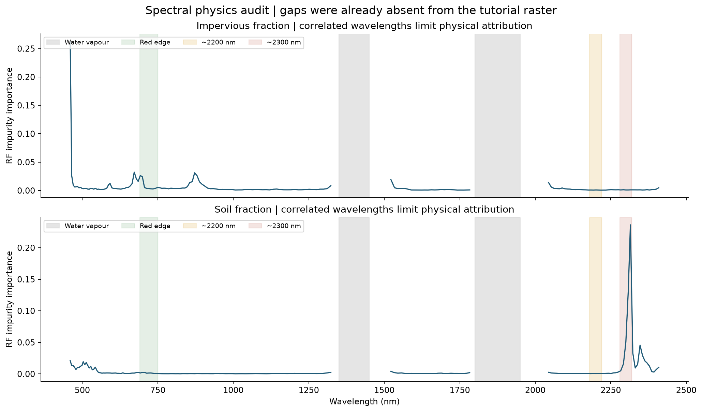
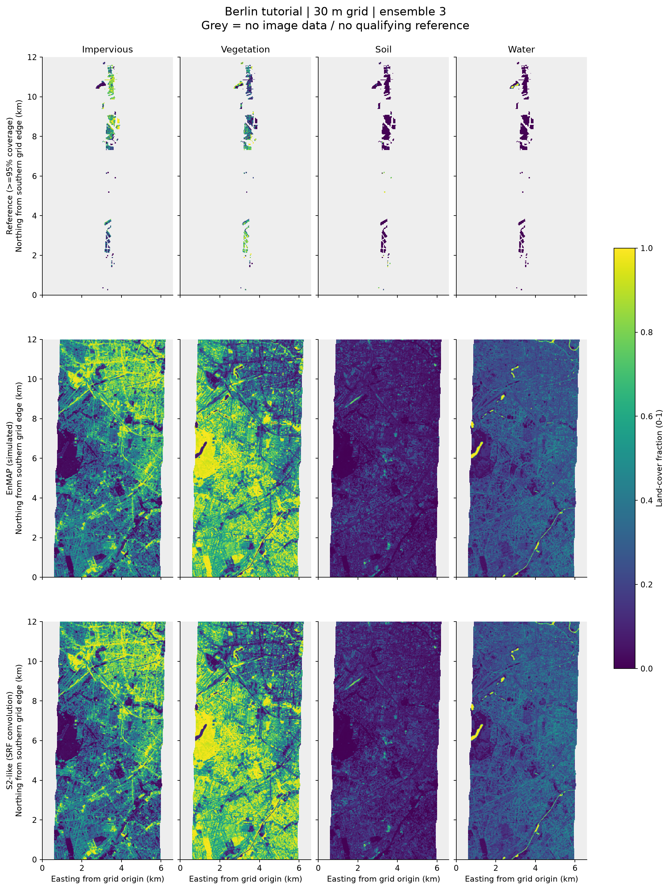
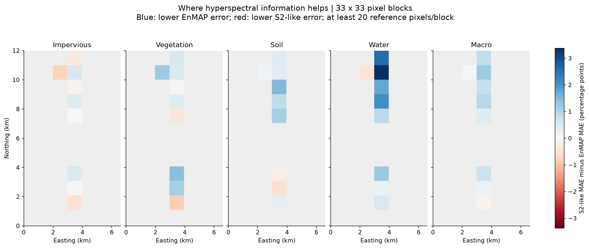
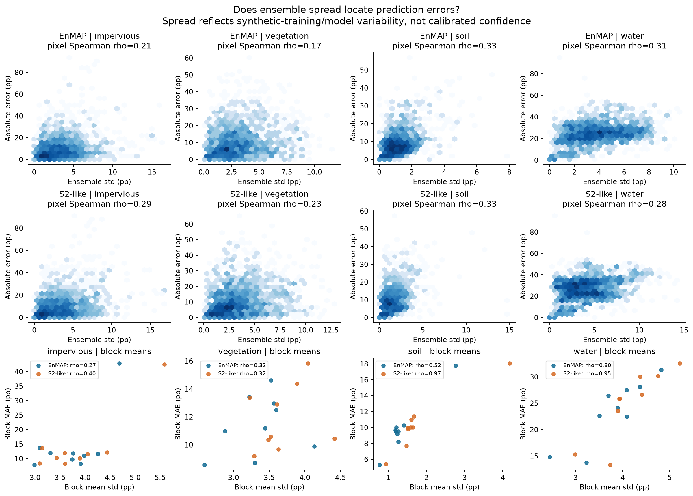
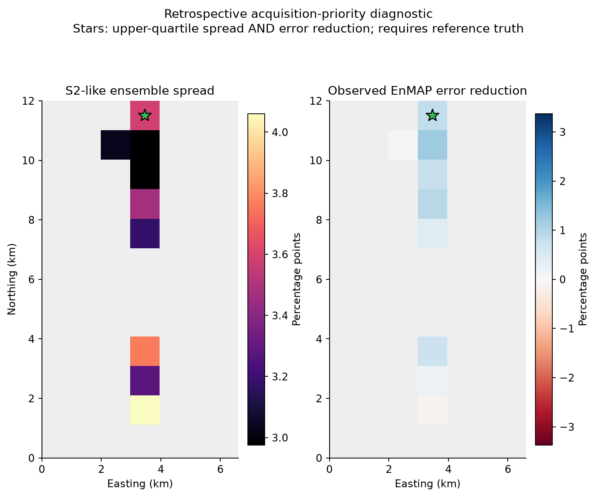

# EnMAP unmixing and spatial error analysis — Berlin tutorial

**Research question:** Does hyperspectral information improve four urban land-cover fractions over Sentinel-2-like spectra, where does it help, and can temporal S2 data add value?

**Main findings:** RF macro MAE falls from 0.1506 to 0.1432: a 0.75 percentage-point gain (paired spatial-block 95% CI 0.41–0.96). Temporal S2 and fixed late fusion show average gains with class-specific trade-offs; fusion worsens water relative to temporal S2. [Stage A sensitivity/diagnosis](results/stage_a_additions/REPORT.md) · [Stage B findings](results/stage_b/RESULTS_SUMMARY.md).

**Limitations:** One Berlin tutorial scene; simulated EnMAP; 1,578 reference pixels in 12 blocks (9 with reporting support); large water bias. Stage B combines 2009/2018/2021 sources and loses all soil-dominated support under the consistency screen. The separate [2025 real-EnMAP first look](REAL_DATA_FIRST_LOOK.md) retains only 3.09% complete-spectrum support and 31 historical reference pixels across a 16-year gap. No official QGIS/EnMAP-Box comparison; this is a Python re-implementation, not a validated reproduction.

[Code: MIT](LICENSE) · [Data attribution and result licenses](DATA_SOURCES.md) · Raw data, GeoTIFFs and caches are excluded; regenerate them locally.

## Measured Stage A results

MAE is expressed as a fraction (0–1); multiply by 100 for percentage points. All sensors use the same **1578 reference pixels**, with at least 95% polygon coverage, and the same synthetic mixtures for each paired run. Positive S2-like minus EnMAP values mean lower EnMAP error.

| class | EnMAP | S2-like | S2-like minus EnMAP |
| --- | --- | --- | --- |
| impervious | 0.1144 | 0.1162 | 0.0018 |
| vegetation | 0.1113 | 0.1159 | 0.0046 |
| soil | 0.0972 | 0.1025 | 0.0053 |
| water | 0.2497 | 0.2679 | 0.0181 |
| macro | 0.1432 | 0.1506 | 0.0075 |

The macro reduction is 0.75 percentage points. This is modest: water remains systematically overestimated (EnMAP mean bias **0.2450**, water R² **-2.82**). Among the 55 pixels with any reference water, EnMAP water MAE is **0.0997** versus S2-like **0.0957**; the overall water improvement therefore does not imply better accuracy on water-containing pixels.

Among dominant-reference contexts, the largest macro-MAE reduction is in **impervious**-dominated pixels (1.28 percentage points). This is conditional on the available reference locations; it is not a statement about all Berlin. Results include negative gains wherever the S2-like model performs better.

### Spatial variability

Blocks are anchored to the upper-left EnMAP grid, 33×33 pixels (~990 m), with at least 20 evaluation pixels per reported block. Overall metrics include all qualifying pixels, including pixels in smaller-support blocks. `contexts.csv` additionally reports dominant-reference class and fixed 25-percentage-point bins of reference impervious fraction.

| sensor | class | n_blocks | block_mae_min | block_mae_median | block_mae_max | share_blocks_above_twice_overall |
| --- | --- | --- | --- | --- | --- | --- |
| EnMAP | impervious | 9 | 0.0784 | 0.1168 | 0.4292 | 0.1111 |
| EnMAP | vegetation | 9 | 0.0857 | 0.1120 | 0.1463 | 0.0000 |
| EnMAP | soil | 9 | 0.0531 | 0.0951 | 0.1777 | 0.0000 |
| EnMAP | water | 9 | 0.1377 | 0.2413 | 0.3134 | 0.0000 |
| EnMAP | macro | 9 | 0.1117 | 0.1468 | 0.2166 | 0.0000 |
| S2-like | impervious | 9 | 0.0822 | 0.1154 | 0.4244 | 0.1111 |
| S2-like | vegetation | 9 | 0.0920 | 0.1059 | 0.1584 | 0.0000 |
| S2-like | soil | 9 | 0.0542 | 0.1002 | 0.1808 | 0.0000 |
| S2-like | water | 9 | 0.1331 | 0.2587 | 0.3259 | 0.0000 |
| S2-like | macro | 9 | 0.1120 | 0.1550 | 0.2154 | 0.0000 |

Paired resampling of spatial blocks gives the following 95% percentile intervals for the pixel-weighted MAE difference. These are descriptive within-scene intervals: adjacent blocks may remain dependent, and they do not establish generalization to another city.

| class | s2_minus_enmap_mae | ci025 | ci975 | n_spatial_blocks |
| --- | --- | --- | --- | --- |
| impervious | 0.0018 | -0.0015 | 0.0036 | 12 |
| vegetation | 0.0046 | 0.0012 | 0.0082 | 12 |
| soil | 0.0053 | 0.0009 | 0.0085 | 12 |
| water | 0.0181 | 0.0085 | 0.0255 | 12 |
| macro | 0.0075 | 0.0041 | 0.0096 | 12 |

### Uncertainty and acquisition priorities

| sensor | class | spearman_pixel_std_abs_error | spearman_block_std_mae |
| --- | --- | --- | --- |
| EnMAP | impervious | 0.2102 | 0.2667 |
| EnMAP | vegetation | 0.1681 | 0.3167 |
| EnMAP | soil | 0.3320 | 0.5167 |
| EnMAP | water | 0.3114 | 0.8000 |
| EnMAP | macro | 0.3153 | 0.5833 |
| S2-like | impervious | 0.2920 | 0.4000 |
| S2-like | vegetation | 0.2294 | 0.3167 |
| S2-like | soil | 0.3338 | 0.9667 |
| S2-like | water | 0.2829 | 0.9500 |
| S2-like | macro | 0.4308 | 0.5500 |

These are rank correlations, not calibrated prediction intervals or independent-pixel significance tests. Standard deviation is across ensemble runs, **not across trees** (`ddof=0`). Each run changes synthetic mixtures and forest seed. `acquisition_priority.png` marks blocks in the upper quartile of both S2-like spread and observed EnMAP error reduction, with positive improvement. Because actual error reduction needs reference truth, this is a **retrospective diagnostic**, not an operational acquisition policy for an unlabelled region. High spread may reflect variability without detecting systematic bias.

Only 9 blocks pass the reporting support threshold. Pixel correlations are weak-to-moderate, and high block correlations for rare classes are exploratory with this small block count; they should not be promoted as established acquisition performance.

### Ensemble sensitivity

The 3-member baseline is the first three members of the same 5-member ensemble; this isolates the effect of adding two runs.

| sensor | class | 3 | 5 |
| --- | --- | --- | --- |
| EnMAP | impervious | 0.1144 | 0.1151 |
| EnMAP | macro | 0.1432 | 0.1424 |
| EnMAP | soil | 0.0972 | 0.0977 |
| EnMAP | vegetation | 0.1113 | 0.1101 |
| EnMAP | water | 0.2497 | 0.2465 |
| S2-like | impervious | 0.1162 | 0.1159 |
| S2-like | macro | 0.1506 | 0.1493 |
| S2-like | soil | 0.1025 | 0.1029 |
| S2-like | vegetation | 0.1159 | 0.1148 |
| S2-like | water | 0.2679 | 0.2634 |

### Tutorial sanity check

The official tutorial screenshot reports 1,578 samples and the class MAEs below. Our values are in the **same broad range**. This checks gross scale, not equivalence: the screenshot has no fixed seed, versioned environment or exact reference-mask specification, and the tutorial's written coverage value is ambiguous (0.95 under a percent-labelled parameter). We implement the requested **95%** explicitly. We checked CRS alignment, spectral units/scaling, target-first mixing, sequential weights, reference area denominators and no-data handling.

| class | tutorial_screenshot_mae | python_mae | difference |
| --- | --- | --- | --- |
| impervious | 0.1179 | 0.1144 | -0.0035 |
| vegetation | 0.1088 | 0.1113 | 0.0025 |
| soil | 0.1094 | 0.0972 | -0.0122 |
| water | 0.2514 | 0.2497 | -0.0017 |

## Re-run

Python 3.13 was used. From the repository root on Windows PowerShell:

```powershell
python -m venv .venv
. .\start.ps1
python -m pip install -r requirements.txt
python download_data.py
python run.py --config config.yaml
```

On Linux/macOS use `source .venv/bin/activate` instead of `start.ps1`. `download_data.py` downloads the pinned ~274 MB EnMAP-Box tutorial archive, checks SHA256 and extracts only the three required inputs. To reuse an existing download: `python download_data.py --archive /path/to/tutorial_materials.zip`. The SRF workbook and Stage B imagery are fetched separately by the pipeline on first use; internet access and additional disk space are required. External service availability is not guaranteed.

`python run.py --config config.yaml --stage prepare` runs input/reference/SRF audits only. `--stage a` runs baseline and sensitivity; `--stage b` runs the configured temporal extension after Stage A has created local rasters/caches. The default runs Stage A, followed by Stage B only when `extension.enabled` is true. Run `python -m unittest discover -s tests -v` for scientific invariants. No GUI is opened.

All numerical settings and seeds are in `config.yaml`; executed settings are recorded in `results/config_used.yaml`. Public configuration snapshots replace the original machine-specific archive path with `data/tutorial_materials.zip`; scientific settings are unchanged. `environment.json` and `requirements.txt` record installed versions. Input and SRF checksums, georeferencing, band decisions, coverage weights, and library counts are saved alongside the results. CPU execution took **146.3 s** (excluding initial installation/downloads); per-model durations are in `model_runtime.csv` and the command log is `run.log`.

## Data and method

- The [official tutorial](https://enmap-box.readthedocs.io/en/latest/usr_section/application_tutorials/urban_unmixing/tutorial.html) supplies a 400×220 pixel, 30 m **simulated** EnMAP scene with 177 bands and 75 endmembers (impervious 38, vegetation 31, soil 4, water 2). All library wavelength axes match the image metadata exactly. Image and library retain the same reflectance scaling; no independent standardization is applied.
- [Tutorial data ZIP](https://box.hu-berlin.de/f/e4fa78c198bc4d868d30/?dl=1). Cite Okujeni, van der Linden & Hostert, *Berlin-Urban-Gradient dataset 2009 — An EnMAP Preparatory Flight Campaign*, [GFZ Data Services](https://doi.org/10.5880/enmap.2016.002), with the [technical report](https://doi.org/10.2312/enmap.2016.002). The original HyMap acquisition was 20 August 2009; the reference data were delineated from cadastre, orthophotos and elevation data, whose exact image dates are not encoded in the tutorial layer. Dataset licence: CC BY-SA 4.0; raw data are downloaded separately rather than redistributed here.
- Reference classes are rasterized at 3 m on the exact 30 m grid using pixel-centre assignment. Fractions are subpixel counts divided by **all 100 subpixels**, matching the official reference algorithm, and are not normalized to covered area. Geometry repairs, when needed, are audited; the original file is preserved.
- For each target class and run: 1,000 mixtures, first endmember from the target, others sampled uniformly over library rows (therefore proportional to class count); 2/3/4 endmembers with probabilities 0.4/0.4/0.2; within-class/repeated draws allowed; sequential uniform allocation of the remaining mixture weight; original 75 endmembers appended with binary target fractions; zero additional background proportion. Rules were checked against the [official SynthMix source](https://github.com/EnMAP-Box/enmap-box/blob/main/enmapboxprocessing/algorithm/prepareregressiondatasetfromsynthmixalgorithm.py), and one separate RF is fitted per target. No reference fractions train the Stage A models.
- RandomForestRegressor: 100 trees, all features available at a split (`max_features=1.0`), leaf minimum 1, bootstrap enabled, OOB scoring enabled as in the [EnMAP-Box RF preset](https://github.com/EnMAP-Box/enmap-box/blob/main/enmapboxprocessing/algorithm/fitrandomforestregressoralgorithm.py). OOB scores refer to synthetic data and are **not** the reference accuracy. Three runs form the baseline; five form sensitivity. Sum-to-one normalization is disabled, following the unconstrained tutorial workflow.
- Ten Sentinel-2-like bands: B2/B3/B4/B5/B6/B7/B8/B8A/B11/B12. Method: **ESA SRF v4.0, S2A, linear interpolation and response integration**, obtained from the [official SentiWiki documents](https://sentiwiki.copernicus.eu/web/s2-documents), not a Gaussian approximation in this run. The response is integrated over linearly interpolated spectral samples, excluding unsupported gaps >35 nm; all integrated SRFs are renormalized to the observed support. Minimum full-SRF area coverage is **0.990**. `s2_response_audit.csv` identifies truncation, especially at the blue edge; this is not an exact simulation of all S2 responses.

## Spectral physics check

The input already omits the major water-vapour windows (gaps [[1323.0, 1522.0], [1783.0, 2044.0]] nm), and none of its 177 finite bands was additionally removed by the configured filter. Peak impurity importance occurs at 460 nm for impervious cover and 2315 nm for soil; the plotted red edge (~690–750 nm), Al-OH/clay region (~2200 nm), and ~2300 nm region provide physical context. Correlated bands, a small synthetic library, and impurity-importance bias prevent these peaks from establishing mineral absorption or causal sensor value.



## Deviations from the EnMAP-Box workflow

- QGIS/EnMAP-Box is not installed yet. No official headless run or pixel-by-pixel output agreement has been measured; that is a later add-on.
- This is an independent Python implementation using NumPy Generator with fixed per-class/run seeds, rather than EnMAP-Box's unseeded global NumPy/Python random generators. The mixing distribution and target/background rules follow the source; the particular random samples differ.
- The installed scikit-learn version is recorded, and need not equal the tutorial's original environment. Parallel execution changes speed, not the intended estimator settings.
- The reference coverage threshold is explicitly 95%; invalid input geometry is repaired in memory with a recorded area/raster audit. Original inputs are unchanged.
- The spectral convolution, paired sensor comparison, spatial summaries, ensemble sensitivity, block resampling, and uncertainty analyses extend the tutorial.

## Limitations

One city, one old scene, simulated EnMAP, a small image-derived library, and sparse polygon references limit interpretation. Endmembers and evaluation imagery share the same parent scene, so this is not an independent-scene generalization test. Soil and water have especially few endmembers and positive reference pixels: their overall MAE can be dominated by absence. `summary.csv` includes positive-reference support and its conditional MAE. Convolved S2-like spectra share EnMAP spatial resolution, source date and radiometry; they do **not** reproduce real S2 atmosphere, spatial point-spread functions, native band resolutions or acquisition differences. The major water-vapour/edge exclusions were already applied to the supplied raster; removing more bands without evidence would alter the baseline. Impurity importance among correlated bands is not causal evidence.

## Stage B and later work

The separately reported [Stage A additions](results/stage_a_additions/REPORT.md) provide paired-block gain intervals and block shares, context decomposition, brightness/shadow-proxy water diagnosis with example spectra, and a standardized SVR sensitivity whose parameters were selected only on synthetic mixtures. They preserve the RF baseline. Re-run only these additions with `python run.py --config config.yaml --stage a-additions`.

Stage B uses independent external WorldCover-derived endmembers, compares single-date and temporal S2 features from the same pixels, and averages temporal S2 and simulated EnMAP predictions without training a joint model. It must prominently report the 2009/S2/WorldCover year differences, class crosswalk limitations and fixed data gates. See `results/stage_b/STATUS.md` when that stage has run. The official QGIS comparison remains pending. The separate [real L2A first look](REAL_DATA_FIRST_LOOK.md) applies the frozen RF and compares actual Sentinel-2; its sparse support and 16-year reference gap prevent a contemporary accuracy claim.

Stage B is complete as a **cross-year method demonstration**, using 2009 simulated EnMAP, 2018 real S2 and 2021 WorldCover. Its common-support macro results are below; they use a different mask from the 1,578-pixel Stage A baseline.

| sensor | mae | n_pixels |
| --- | --- | --- |
| c0_S2_best_date | 0.1597 | 1495 |
| c_S2_temporal | 0.1545 | 1495 |
| a_EnMAP_library | 0.1450 | 1495 |
| b_S2_like_library | 0.1524 | 1495 |
| d_late_fusion | 0.1393 | 1495 |

See the [Stage B results and limits](results/stage_b/RESULTS_SUMMARY.md) and [full methods](results/stage_b/STATUS.md). **All 39 soil-dominated reference pixels fail the WorldCover consistency screen**; the primary full-support results retain them. Time-series and fixed fusion gains are class-dependent: fusion improves average error but worsens water relative to temporal S2. Date mismatch confounds any acquisition-value interpretation.

Future ideas only: vegetation/burned-area fraction changes around a wildfire, and larger-area mapping along an EnMAP Foreground flightline. Stage C scaling and real EnMAP transfer are not part of these Stage A results.

## Figures and outputs






Published outputs: `summary.csv`, `blocks.csv`, `block_differences.csv`, `contexts.csv`, `paired_block_bootstrap.csv`, input/band/SRF audits, model timings and PNG figures. GeoTIFF fraction/uncertainty maps and cached ensemble predictions are generated locally and excluded from the public repository, along with all raw tutorial inputs.
