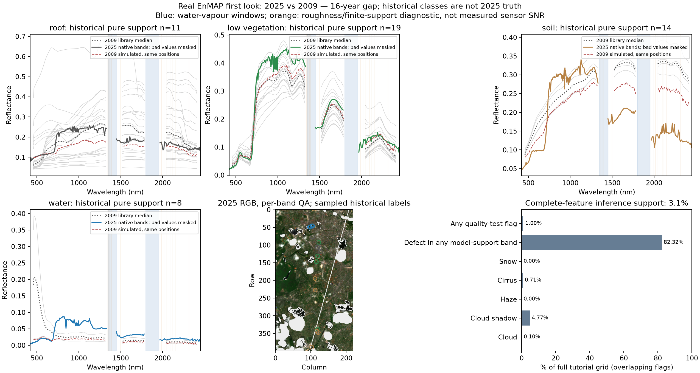
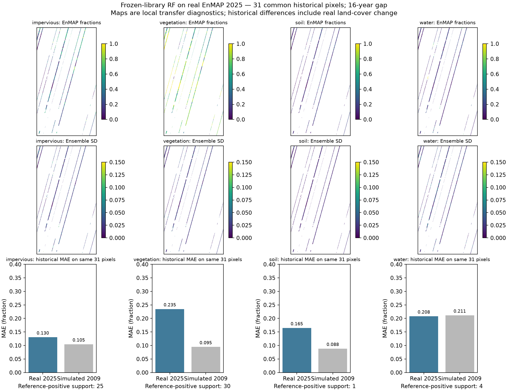

# Real EnMAP first look — Berlin, 2025-05-11

**16-year calendar gap:** 2025 real EnMAP versus the 2009 simulated scene/reference.
These are historical discrepancies, combining model/sensor, geometry, season and
genuine land-cover change; they do not establish same-date transfer accuracy.

XML confirms centre acquisition **2025-05-11 10:42:03.869622 UTC**, processing-chain
version **01.05.02**, 224 bands (418.416–2445.3 nm),
viewing zenith **9.557 degrees**,
viewing azimuth **103.265 degrees**,
solar elevation/azimuth **55.329/171.341 degrees**.
Reflectance is **DN x 0.0001 + 0**, applied exactly once; raw nodata is **-32768**.
Land mode, bilinear, terrain correction, no cirrus/haze removal or band interpolation.

Atmospheric/testflag-clear nearest-grid share: 86.60%. **Conservative complete-feature inference support: 2,721/88,000 pixels (3.09% of the full tutorial rectangle; 3.06% of valid simulated-image support).** Historical reference overlap: 31 pixels. Reject cloud, cloud shadow, haze, any cirrus, snow, defective source bands and any quality-test flag; every bilinear contributor must pass. Individual flag shares overlap.

Historical >=95%-pure atmospheric-clear support: roof 11, low vegetation 19, soil 14, water 8. Samples use 2009 roof/low-vegetation/soil/water labels, not independently verified 2025 identities. Water-vapour windows and a fixed spectral-roughness/finite-support proxy are marked; this proxy is not measured sensor SNR. The historical soil and water groups have 2025 median-spectrum NDVI 0.50 and 0.60; their signatures warn against treating the old labels as current pure materials.

Frozen 3-member library RF applied to 2,721 real QA-clear pixels. MAE below uses the identical 31 reference pixels for both dates.

| Fraction | Real 2025 vs 2009 MAE | Simulated 2009 MAE, same pixels |
| --- | ---: | ---: |
| impervious | 0.1305 | 0.1046 |
| vegetation | 0.2347 | 0.0946 |
| soil | 0.1647 | 0.0884 |
| water | 0.2081 | 0.2114 |
| macro | 0.1845 | 0.1248 |

Dominant-reference support (impervious/vegetation/soil/water): 17/10/1/3; these 31 spatially sparse pixels cannot establish generalization.

Real spectra are bilinearly aligned to the exact tutorial grid and linearly
interpolated to its frozen 177-band axis; no extrapolation or gaps >35 nm.
At a gap boundary, nearest-band mapping is allowed only within half its FWHM and
5 nm (1783 maps to 1780.22 nm); the gap itself is never bridged.
This approximates differing spectral responses. No reference-fitted correction,
normalization, tuning or sum-to-one is applied. All 12 rebuilt EnMAP estimators
exactly reproduce saved Stage A predictions. The extra S2-like branch is a
sensitivity: one estimator differs at 2/71,158 replay pixels (maximum 0.009905).
Ensemble SD is across 3 runs, not calibrated uncertainty; nominal georeferencing
may contribute to apparent errors. AROSICS/actual-S2 checks are not yet completed.

Raw files, model objects, detailed tables and fraction/uncertainty GeoTIFFs remain
local under ignored `data/real_enmap/20250511/`. Only code/configuration, this report
and two figures are published. Credentials are local and never logged. Deadline:
**2026-11-04 15:30 Europe/Berlin**. Re-run with `python real_enmap.py --stage metadata`,
`--stage download`, `--stage quality`, `--stage spectra`, `--stage transfer`.

[DLR scene metadata](https://geoservice.dlr.de/eoc/ogc/stac/v1/collections/ENMAP_HSI_L2A/items/ENMAP01-____L2A-DT0000129412_20250511T104201Z_009_V010502_20250515T040235Z) ·
[Quality codes: product specification section 4.5](https://www.enmap.org/data/doc/EN-PCV-ICD-2009-2_HSI_Product_Specification_Level1_Level2.pdf).

