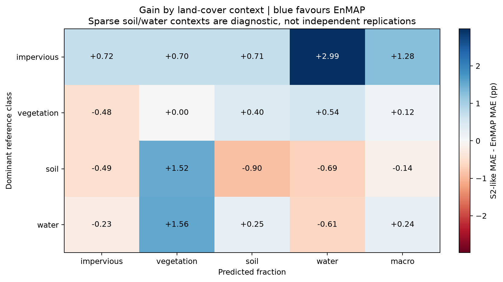
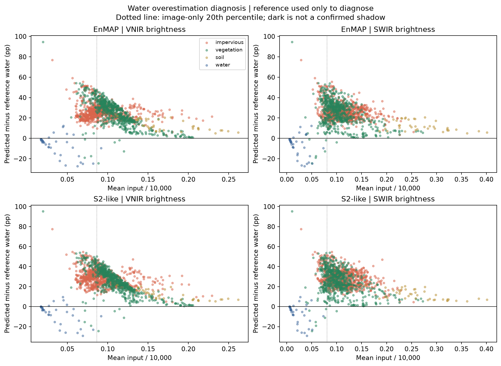
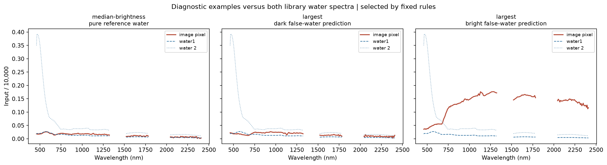

# Stage A additions — frozen RF baseline

## Does EnMAP improve MAE in this scene?

The existing **2000 paired resamples of ~1 km blocks** give the 95% percentile intervals below. Positive differences mean lower EnMAP MAE. All 12 blocks with reference pixels enter the resampling with pixel-weighted aggregation; nine >=20-pixel blocks enter the supported-block share. Shares are unweighted proportions of blocks. This is within-scene evidence; neighbouring blocks, a shared parent image/library, and a small number of spatial units limit inference.

| class | s2_minus_enmap_mae | ci025 | ci975 | share_all_blocks_enmap_better | share_supported_blocks_enmap_better |
| --- | --- | --- | --- | --- | --- |
| impervious | 0.0018 | -0.0015 | 0.0036 | 0.4167 | 0.3333 |
| vegetation | 0.0046 | 0.0012 | 0.0082 | 0.7500 | 0.6667 |
| soil | 0.0053 | 0.0009 | 0.0085 | 0.6667 | 0.7778 |
| water | 0.0181 | 0.0085 | 0.0255 | 0.8333 | 0.8889 |
| macro | 0.0075 | 0.0041 | 0.0096 | 0.9167 | 0.8889 |

If an interval crosses zero, these data do not clearly resolve that class's gain under this resampling. A positive interval is not evidence for other scenes or missions. `rf_gain_by_context.csv` includes dominant-reference contexts, impervious gradients, and vegetation-mixture bins; the heatmap separates impervious/soil/vegetation confusions. Rare soil/water contexts have few pixels, and reference polygons are not spatially representative of the whole scene.

## Water overestimation: diagnosis only

The brightness thresholds, false-water rule and example-selection rules were fixed in `STAGE_A_ADDITIONS_DESIGN.md` before running these additions. Darkness requires low mean VNIR **and** SWIR relative to image-only 20th-percentile thresholds. It can represent water, shadow, dark materials or mixtures; no independent shadow labels exist here. The RF baseline remains unchanged, with no reference-trained correction and no sum-to-one experiment.

Water error by dominant reference context (EnMAP):

| context | n_pixels | mean_predicted_water | mean_reference_water | water_bias | water_mae | false_water_pixel_share |
| --- | --- | --- | --- | --- | --- | --- |
| impervious | 857 | 0.2610 | 0.0001 | 0.2608 | 0.2608 | 0.4994 |
| vegetation | 644 | 0.2561 | 0.0065 | 0.2496 | 0.2521 | 0.5342 |
| soil | 39 | 0.1258 | 0.0000 | 0.1258 | 0.1258 | 0.0000 |
| water | 38 | 0.7937 | 0.8608 | -0.0671 | 0.0875 | 0.0000 |

Darkness proxy:

| context | n_pixels | water_bias | water_mae | false_water_pixel_share |
| --- | --- | --- | --- | --- |
| other | 1410 | 0.2445 | 0.2453 | 0.4844 |
| dark_VNIR_and_SWIR | 168 | 0.2488 | 0.2871 | 0.5298 |

Brightness associations (positive signed-error correlation means overprediction increases with brightness):

| sensor | brightness | subset | spearman_signed_water_error | spearman_absolute_water_error |
| --- | --- | --- | --- | --- |
| EnMAP | mean_VNIR | all | -0.3177 | -0.3369 |
| EnMAP | mean_VNIR | reference_water_absent | -0.4279 | -0.4279 |
| EnMAP | mean_SWIR | all | -0.1945 | -0.2150 |
| EnMAP | mean_SWIR | reference_water_absent | -0.3132 | -0.3132 |
| S2-like | mean_VNIR | all | -0.4663 | -0.4846 |
| S2-like | mean_VNIR | reference_water_absent | -0.5915 | -0.5915 |
| S2-like | mean_SWIR | all | -0.2412 | -0.2594 |
| S2-like | mean_SWIR | reference_water_absent | -0.3657 | -0.3657 |

These associations diagnose confounding, not a causal effect of shadows or brightness. `water_example_pixels.csv` records deterministic true-water and false-water examples and their coordinates, fractions and brightness. The example spectra are diagnostic extrema/representative controls, not a random accuracy sample. Similar dark signatures and only two water endmembers limit spectral discrimination; systematic overestimation with low reference water is consistent with the tutorial's own diagnosis. The plots show whether the chosen false-water examples are dark or remain spectrally different from water; they do not by themselves establish the mechanism.

For this scene, water overprediction increases as brightness decreases (see the negative nonwater-only rank correlations), but it is **not confined to the darkness proxy**: 683 false-water pixels are outside it versus 89 inside. The fixed training design is another plausible contributor: 93.2% of water-target training rows contain positive water, with mean synthetic water fraction 0.487, compared with mean reference water 0.023. Only 73 original nonwater endmembers explicitly anchor zero water. This mismatch and the dark-surface spectral ambiguity are diagnostic explanations, not causal tests; no training prior was adjusted to the reference.

## SVR method sensitivity

The original methodological work used SVR ([Okujeni et al., 2017](https://doi.org/10.1109/JSTARS.2016.2634859)); the tutorial selects RF for speed. Our variant fits StandardScaler on **synthetic training mixtures only**, then uses RBF SVR. A single common **C=100, epsilon=0.01, gamma=scale** was selected by pooled synthetic-validation MAE across all four targets and both sensors. The six candidate pairs and all synthetic scores are saved in `svr_synthetic_parameter_scores.csv`. Each target's 400 validation mixtures use separate seeds and exclude appended original endmembers; validation still shares the same material library and therefore measures mixture interpolation.

After selection, the pair was frozen and the three RF baseline seeds/mixtures were reused for paired SVR fits. Predictions are clipped to [0,1] by the predeclared sensitivity rule; raw out-of-range rates are in `svr_runtime_and_bounds.csv`. No sum-to-one constraint is applied, and no reference errors chose hyperparameters or bounds. This is a labelled SVR sensitivity, not a replacement RF baseline or a claim to replicate the original paper's full SVR setup.

| method | class | EnMAP | S2-like | gain |
| --- | --- | --- | --- | --- |
| RF | impervious | 0.1144 | 0.1162 | 0.0018 |
| RF | macro | 0.1432 | 0.1506 | 0.0075 |
| RF | soil | 0.0972 | 0.1025 | 0.0053 |
| RF | vegetation | 0.1113 | 0.1159 | 0.0046 |
| RF | water | 0.2497 | 0.2679 | 0.0181 |
| SVR | impervious | 0.1076 | 0.1044 | -0.0032 |
| SVR | macro | 0.1084 | 0.1266 | 0.0182 |
| SVR | soil | 0.0367 | 0.0812 | 0.0445 |
| SVR | vegetation | 0.1029 | 0.1167 | 0.0138 |
| SVR | water | 0.1865 | 0.2041 | 0.0175 |

For RF vs SVR, **the macro gain has the same sign**: macro S2-like-minus-EnMAP MAE is 0.00746 for RF and 0.01817 for SVR. Per-class signs and magnitudes must be inspected individually; estimator sensitivity does not validate a universal hyperspectral advantage.

Classes whose sensor-gain sign changes between RF and SVR: **impervious**. This directly limits class-specific conclusions from the RF baseline.

SVR paired spatial-block intervals:

| class | s2_minus_enmap_mae | ci025 | ci975 |
| --- | --- | --- | --- |
| impervious | -0.0032 | -0.0144 | 0.0050 |
| vegetation | 0.0138 | 0.0004 | 0.0223 |
| soil | 0.0445 | 0.0293 | 0.0510 |
| water | 0.0175 | -0.0030 | 0.0314 |
| macro | 0.0182 | 0.0070 | 0.0247 |

Full per-class accuracy, contexts, block metrics and uncertainty/error correlations are in `svr_summary.csv`, `svr_contexts.csv`, `svr_blocks.csv` and `rf_svr_comparison.csv`. The fixed RF baseline files remain unchanged.
