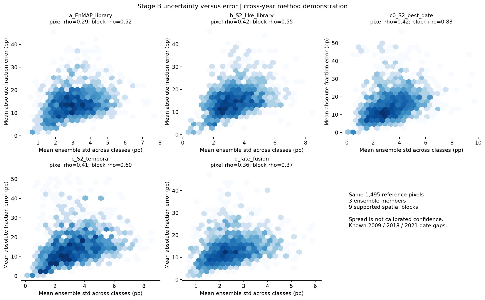
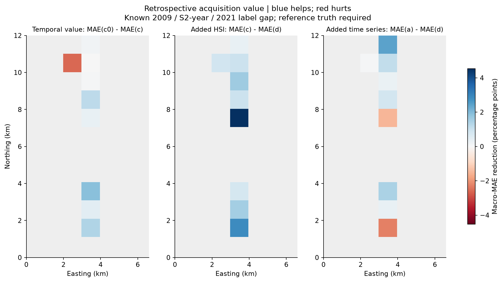

# Stage B results and limits

**This is a 2009 simulated-EnMAP / 2018 real-S2 / 2021 WorldCover method demonstration. The 9-year image gap and 3-year S2/label gap prevent same-date sensor claims.**

All predefined gates passed. Both temporal models use the same external endmember pixels and the same 13-feature schema (one-date versus full-season statistics), with no reference-fraction training. The independent endmembers are outside the whole tutorial extent plus a 1 km gap.

| class | WorldCover_year | endmembers_used |
| --- | --- | --- |
| impervious | 2021 | 239 |
| vegetation | 2021 | 250 |
| soil | 2021 | 194 |
| water | 2021 | 248 |

## Accuracy on identical support

All five models use 1,495 reference pixels; the full original reference has 1,578. 83 pixels lack common best-date/seasonal support. Under the fixed WorldCover consistency screen, 1,205 common pixels remain. Units below are 0–1 fractions.

| class | a_EnMAP_library | b_S2_like_library | c0_S2_best_date | c_S2_temporal | d_late_fusion |
| --- | --- | --- | --- | --- | --- |
| impervious | 0.1166 | 0.1183 | 0.1464 | 0.1480 | 0.1144 |
| vegetation | 0.1127 | 0.1180 | 0.1538 | 0.1599 | 0.1140 |
| soil | 0.0995 | 0.1051 | 0.2646 | 0.2577 | 0.1773 |
| water | 0.2512 | 0.2683 | 0.0738 | 0.0523 | 0.1514 |
| macro | 0.1450 | 0.1524 | 0.1597 | 0.1545 | 0.1393 |

| class | time_gain_c0_minus_c | fusion_gain_c_minus_d | fusion_gain_a_minus_d |
| --- | --- | --- | --- |
| impervious | -0.0016 | 0.0337 | 0.0023 |
| vegetation | -0.0060 | 0.0459 | -0.0013 |
| soil | 0.0069 | 0.0804 | -0.0778 |
| water | 0.0215 | -0.0992 | 0.0998 |
| macro | 0.0052 | 0.0152 | 0.0057 |

- Time-series macro gain over the same-source best date is **0.518 pp**. Water improves, while vegetation and impervious fractions worsen on this primary support. Thus the added temporal features do not uniformly close a spectral gap.
- Fixed fusion reduces macro MAE from **0.1545 to 0.1393** relative to temporal S2, and from **0.1450 to 0.1393** relative to the old EnMAP model.
- Fusion worsens water relative to temporal S2: **0.0523 -> 0.1514**. It also worsens soil relative to EnMAP alone: **0.0995 -> 0.1773**. Fixed averaging propagates each source's systematic errors; no weights were fitted to the reference to hide that trade-off.
- The "value of an acquisition" map is retrospective `MAE(c)-MAE(d)` against historical reference. Adding an old-date map is confounded by reference date and does not measure the benefit of obtaining a new EnMAP observation today.

## Consistency is not demonstrated stability

| dominant_reference | n_reference | n_matching_WorldCover | agreement |
| --- | --- | --- | --- |
| impervious | 857 | 766 | 0.8938 |
| vegetation | 644 | 488 | 0.7578 |
| soil | 39 | 0 | 0.0000 |
| water | 38 | 31 | 0.8158 |

**All 39 soil-dominated reference pixels fail the WorldCover agreement screen.** They remain in the primary full-support comparison, but none remains in the screened subset. The overall 81.4% agreement gate is dominated by vegetation/impervious locations and must not be read as class-wise agreement. WorldCover bare/sparse labels, historical soil definitions and real land-cover change cannot be separated here. The screened soil MAE is therefore not a test on soil-dominated sites. Lower screened error alone does not establish a more reliable model.

## Ensemble spread versus error

Pixel rank correlations by fraction and macro block correlation (only nine supported blocks):

| sensor | impervious | macro | soil | vegetation | water | macro_block_rho |
| --- | --- | --- | --- | --- | --- | --- |
| a_EnMAP_library | 0.1951 | 0.2945 | 0.3215 | 0.1525 | 0.3136 | 0.5167 |
| b_S2_like_library | 0.2759 | 0.4176 | 0.3431 | 0.2268 | 0.2989 | 0.5500 |
| c0_S2_best_date | 0.2551 | 0.4212 | 0.4557 | 0.1525 | 0.7244 | 0.8333 |
| c_S2_temporal | 0.2919 | 0.4115 | 0.4084 | 0.1485 | 0.8523 | 0.6000 |
| d_late_fusion | 0.1780 | 0.3562 | 0.3070 | 0.1149 | 0.4207 | 0.3667 |

These are associations under model/synthetic-mixture variability, not calibrated uncertainty or independent-scene evidence.

## Acquisition proxy and data audit

The strict local usable-area rule succeeds on 6/85 dates in 2018: plug-in probability **0.0706**, giving **14.17** attempts under an independent, stationary S2-to-EnMAP cloudiness proxy. SCL classes 4/5/6 also reflect classification/shadow behaviour, and zero-success months do not imply a truly zero probability. The separate scene-level <=20% cloud proxy is in `monthly_acquisition_proxy.csv`; it is not interchangeable with local SCL usability.

Five selected assets had contradictory offset metadata. Same-date red/NIR/SWIR comparisons with legacy assets, without using reference labels or prediction errors, establish that their -0.1 correction had already been applied. The explicit item whitelist and audit guard prevent double subtraction. Declared and effective offsets, dates, item IDs and URLs are saved in `radiometric_calibration_by_date_band.csv`. This is a data-quality correction, not a fitted model adjustment.

Full methods and both support tables: [STATUS.md](STATUS.md). Core evidence: `summary.csv`, `blocks.csv`, `contexts.csv`, `model_gain_summary.csv`, `value_of_acquisition_blocks.csv`, `evaluation_support_by_context.csv`, and the two mask GeoTIFFs. Summary-feature mixing of NDVI/medians/amplitude is an approximation rather than physically exact mixing of complete time series.

Stage C scaling, official QGIS comparison and real EnMAP transfer remain later additions.
