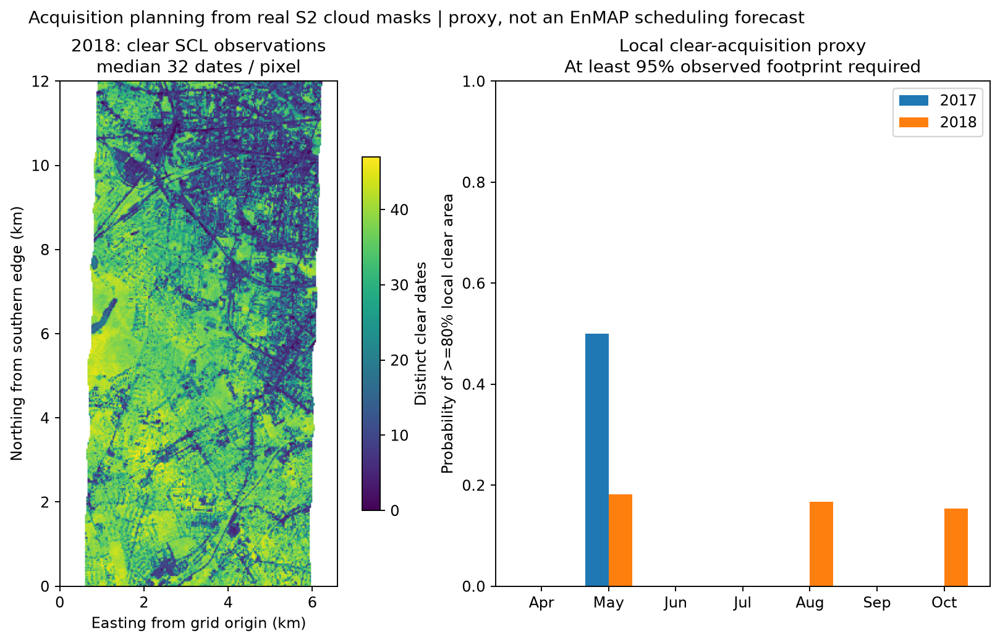
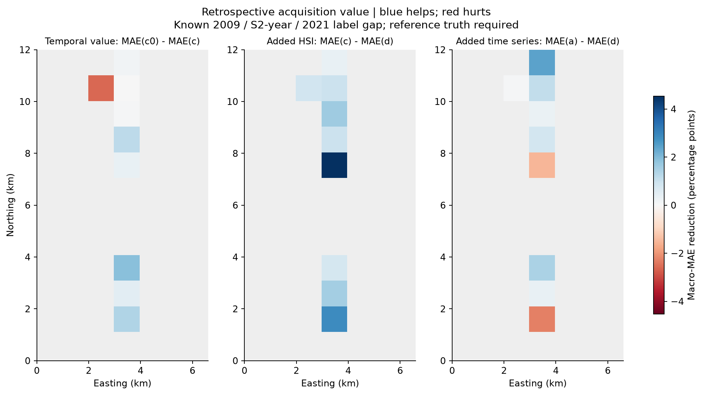
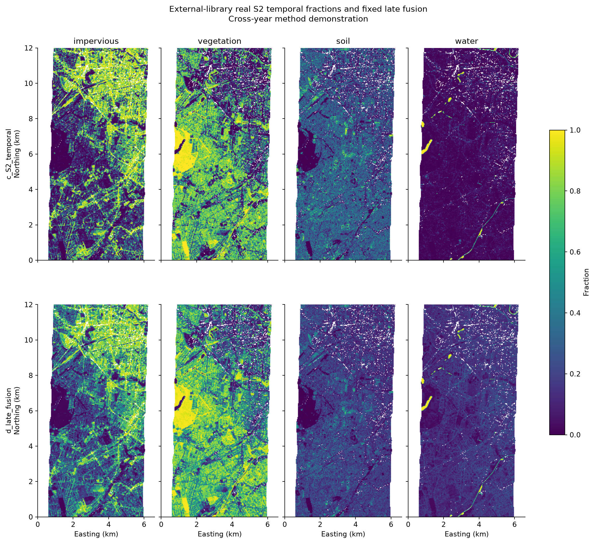

# Stage B — method demonstration under a known time gap

**Dates: HyMap/simulated EnMAP 2009; real S2 growing season 2018 (gap 9 years); external WorldCover labels 2021 (another 3 years after S2). These results are not a same-date sensor comparison.**

The fixed support/cloud/agreement gates passed. The external library lies outside the entire tutorial extent plus a 1 km exclusion, within a 10 km buffer. WorldCover dominant-class agreement is 81.4%: 1285/1578 pixels before cloud-driven exclusions. This consistency screen is not proof of temporal stability and preferentially selects agreement with the map used to label the training library; the full-area result below is therefore primary.

External endmembers retained after fixed cloud/feature filtering:

| class | worldcover_year | used_endmembers |
| --- | --- | --- |
| impervious | 2021 | 239 |
| vegetation | 2021 | 250 |
| soil | 2021 | 194 |
| water | 2021 | 248 |

## Primary matched-support results

All five models use the same **1495** qualifying reference pixels, with 83 excluded because of missing/cloud-limited single-date/seasonal support. Fractions and MAE are on a 0–1 scale. Fixed Stage A models are re-evaluated on this common support, not substituted with the original full-support Stage A metric.

`evaluation_support_by_context.csv` gives the retained counts by dominant class, and the two evaluation-mask GeoTIFFs make all exclusions inspectable.

| class | a_EnMAP_library | b_S2_like_library | c0_S2_best_date | c_S2_temporal | d_late_fusion |
| --- | --- | --- | --- | --- | --- |
| impervious | 0.1166 | 0.1183 | 0.1464 | 0.1480 | 0.1144 |
| vegetation | 0.1127 | 0.1180 | 0.1538 | 0.1599 | 0.1140 |
| soil | 0.0995 | 0.1051 | 0.2646 | 0.2577 | 0.1773 |
| water | 0.2512 | 0.2683 | 0.0738 | 0.0523 | 0.1514 |
| macro | 0.1450 | 0.1524 | 0.1597 | 0.1545 | 0.1393 |

## WorldCover-consistency sensitivity

1205 common-supported pixels remain under the predeclared WorldCover/reference class-agreement mask.

| class | a_EnMAP_library | b_S2_like_library | c0_S2_best_date | c_S2_temporal | d_late_fusion |
| --- | --- | --- | --- | --- | --- |
| impervious | 0.0967 | 0.0980 | 0.1200 | 0.1190 | 0.0881 |
| vegetation | 0.1039 | 0.1086 | 0.1248 | 0.1251 | 0.0910 |
| soil | 0.0952 | 0.1008 | 0.2432 | 0.2356 | 0.1644 |
| water | 0.2496 | 0.2680 | 0.0727 | 0.0499 | 0.1494 |
| macro | 0.1364 | 0.1439 | 0.1402 | 0.1324 | 0.1232 |

## Reference consistency by class

| dominant_reference | n_reference | n_matching_WorldCover | agreement |
| --- | --- | --- | --- |
| impervious | 857 | 766 | 0.8938 |
| vegetation | 644 | 488 | 0.7578 |
| soil | 39 | 0 | 0.0000 |
| water | 38 | 31 | 0.8158 |

**No soil-dominated reference pixels remain in the consistency-screened subset.** Use the full-support comparison as primary; the screen does not establish temporal stability. See [measured trade-offs](RESULTS_SUMMARY.md).

## Method and provenance

- Years 2017 and 2018 were both queried over Apr–Oct, deduplicated to one completely covering/lower-cloud item per date and compared by median then 10th-percentile clear SCL counts; selection did not use reference errors. `year_selection.csv`, `daily_cloud_*.csv` and `cube/stac_*.json` record this.
- STAC + odc-stac produced an xarray/Dask cube on the exact 30 m EnMAP grid. SCL 4/5/6 were retained with nearest-neighbour resampling; spectral bands used average resampling. Metadata scale/offset are checked before feature extraction. `radiometric_calibration.json` records them.
- External candidate labels use [ESA WorldCover](https://planetarycomputer.microsoft.com/dataset/esa-worldcover), CC BY 4.0. The 10 m labels were sampled on an aligned 10 m UTM grid and aggregated 3×3. At >=95% mapped purity, all nine samples must agree. Class crosswalk: built-up -> impervious; bare/sparse -> soil; permanent water -> water; trees/shrubs/grass/crops/wetlands/moss -> vegetation. Built-up is not identical to impervious cover, and mapped purity is not physical spectral purity.
- (c0) uses the single date **2018-05-29**, selected by external-library clear coverage only. Both (c0)/(c) use the same 13-feature schema: ten band medians plus NDVI median, maximum and amplitude. For the one-date view, each band median is that date's value, NDVI median=max and amplitude=0; the temporal view summarizes the season. Thus NDVI feature engineering is available to both models. They use exactly the same external endmember locations after common cloud/feature filtering. `external_endmembers_used.csv` and `external_endmember_features.csv` list counts, coordinates and actual features. Neither model trains on tutorial reference fractions.
- Synthetic temporal mixing operates in this summary-feature space as specified in the design. NDVI, medians and amplitude are nonlinear functions of reflectance; linearly mixing those features is a modelling approximation, not exact physical mixing of complete multitemporal reflectance sequences.
- Target-first mixing, original endmembers, complexity probabilities and RF settings match Stage A. Three synthetic-training/model seeds define ensemble spread. (d) averages corresponding members of (a) and (c) with fixed 0.5/0.5 weights and no additional training. This is a direct late-fusion sensitivity, not an optimized combination.
- Original library (a)/(b) and external-library (c0)/(c) have different source spectra and class counts. The clean temporal comparison is **c0 vs c**, and the fixed addition-of-hyperspectral comparison is **c vs d**; other contrasts also include library/domain changes. Historical class changes and WorldCover label errors can make an apparently pure external label wrong for the selected S2 year.
- `summary.csv`, `blocks.csv` and `contexts.csv` report per-class metrics, dominant-reference/impervious-gradient contexts and pixel/block spread–error rank correlations for both masks. No independent-pixel significance is claimed. The `value_of_acquisition_blocks.csv` differences and map require reference truth and are retrospective.
- Adding the **2009** simulated hyperspectral map to **2018** S2 is confounded by their different dates and the historical reference. A reduction in old-reference error is not a measured benefit of acquiring a new hyperspectral scene in the S2 year or today.
- Five reprocessed assets advertised a -0.1 offset despite already offset-corrected pixel values. Same-date legacy comparisons over 71,158 pixels in red/NIR/SWIR confirmed this independently of reference labels. Only the explicitly audited item IDs use effective offset zero; both declared and effective offsets appear in `radiometric_calibration_by_date_band.csv`. `same_date_radiometric_audit.csv` and the fixed QC amendment document the evidence.

## Acquisition planning

`monthly_acquisition_proxy.csv` reports distinct dates, the probability that >=80% of the local valid footprint is clear and >=95% is observed, and `1/p` expected attempts. S2 cloudiness proxies EnMAP: independent attempts, stationary success probability, matched geographic conditions and unconstrained scheduling are assumptions, not established mission performance. A zero-success month has no finite plug-in attempt estimate. Same-day products are not treated as independent acquisition opportunities.

Clear dates here mean strict SCL classes 4/5/6. The spatial counts also reflect SCL classification/shadow behaviour and may depend on surface type; they are not a pure meteorological cloud record. A second, scene-level <=20% cloud-cover proxy is reported alongside the local SCL proxy, rather than treating the two as interchangeable.

Stage C scaling, official QGIS comparison and real EnMAP transfer were not run.
